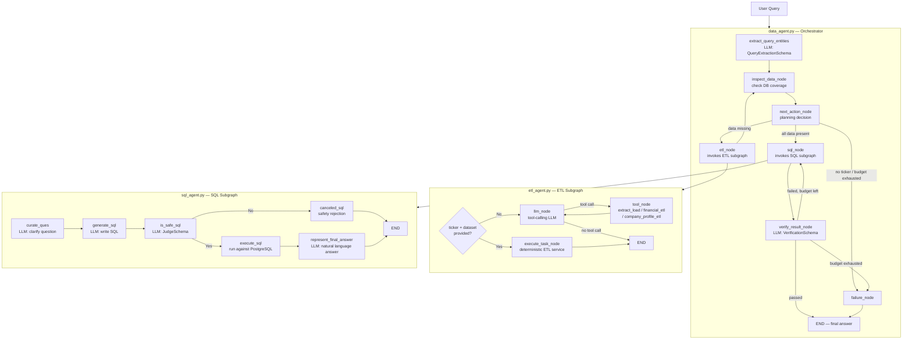

# Agents

LangGraph-powered agent graphs that answer financial data questions end-to-end.  
Three cooperating graphs handle the full request lifecycle: understanding the query, fetching missing data, generating and executing SQL, and verifying the result.

---

## Table of Contents

- [Directory Structure](#directory-structure)
- [System Architecture](#system-architecture)
- [Agent Reference](#agent-reference)
  - [Data Agent (`data_agent.py`)](#data-agent-data_agentpy)
  - [ETL Agent (`etl_agent.py`)](#etl-agent-etl_agentpy)
  - [SQL Agent (`sql_agent.py`)](#sql-agent-sql_agentpy)
- [State Schemas](#state-schemas)
- [LLM Tiers](#llm-tiers)
- [Key Design Decisions](#key-design-decisions)
- [Retry & Error Budget](#retry--error-budget)
- [Graph Visualisation](#graph-visualisation)
- [How to Invoke](#how-to-invoke)

---

## Directory Structure

```
agents/
├── __init__.py          # Empty package marker
├── data_agent.py        # Top-level orchestrator graph (DataAgentSchema)
├── etl_agent.py         # ETL specialist subgraph (ETLAgentSchema)
└── sql_agent.py         # SQL specialist subgraph (AgentSchema)
```

Supporting modules referenced by agents:

| Path | Purpose |
|------|---------|
| `Models/schema.py` | All Pydantic state schemas + structured-output schemas |
| `utils/llm_picker.py` | `get_llm(level)` — selects the right LLM by cost tier |
| `utils/prompts.py` | All LangChain prompt templates |
| `utils/etl_tools.py` | `ETLTools` — raw HTTP extract-load utility |
| `database/coverage.py` | `check_requested_coverage()` — checks DB for available years |
| `database/etl_service.py` | `fetch_and_load_*` — deterministic ETL service layer |
| `database/database.py` | `DatabaseUtils` — schema introspection + SQL execution |

---

## System Architecture



---

## Agent Reference

### Data Agent (`data_agent.py`)

**Entry point:** `build_data_agent_graph()` → compiled LangGraph  
**State:** `DataAgentSchema`

The top-level orchestrator. It owns the **plan–act–verify loop** and delegates to the two specialist subgraphs.

#### Nodes

| Node | Function | Description |
|------|----------|-------------|
| `extract_query_entities` | `extract_query_entities()` | LLM extracts ticker, dataset names, and fiscal years from the user query (`QueryExtractionSchema`) |
| `inspect_data_node` | `inspect_data_node()` | Calls `check_requested_coverage()` to determine which years are present vs. missing in the DB |
| `next_action_node` | `next_action_node()` | Pure Python decision: route to ETL, SQL, or failure based on coverage + attempt budget |
| `etl_node` | `etl_node()` | Invokes `build_etl_graph()` once per missing dataset; loops back to `inspect_data_node` |
| `sql_node` | `sql_node()` | Invokes `build_sql_graph()`; passes previous SQL + error as retry context |
| `verify_result_node` | `verify_result_node()` | Two-stage verify: (1) deterministic execution checks, (2) LLM `VerificationSchema` |
| `failure_node` | `failure_node()` | Sets a human-readable failure answer; always routes to END |

#### Edge Logic

```
START → extract_query_entities → inspect_data_node → next_action_node
                                                           │
                              ┌────────────────────────────┤
                              │                            │
                        fetch_missing_data          query_database        fail
                              │                            │                │
                           etl_node ─────────────► sql_node        failure_node
                              │                       │                    │
                              └──► inspect_data_node  ▼                  END
                                                 verify_result_node
                                                  │           │
                                               finish       retry_sql / fail
                                                  │                │
                                                 END          sql_node / failure_node
```

#### Retry Budget

| Counter | Default | Reset on |
|---------|---------|----------|
| `attempts` (ETL) | 3 | Never within a run |
| `sql_attempts` (SQL) | 3 | Never within a run |

---

### ETL Agent (`etl_agent.py`)

**Entry point:** `build_etl_graph()` → compiled LangGraph  
**State:** `ETLAgentSchema`

Specialist subgraph responsible for fetching missing financial data from FMP and loading it into PostgreSQL.

#### Tools

| Tool | LangChain `@tool` | Purpose |
|------|-------------------|---------|
| `extract_load_tool` | ✅ | Generic HTTP extract → file save (`csv` or `json`) |
| `financial_etl` | ✅ | Fetch + load income / balance / cash-flow statements for specific years |
| `company_profile_etl` | ✅ | Fetch + load company profile record |

#### Nodes

| Node | Function | Description |
|------|----------|-------------|
| `execute_task` | `execute_task_node()` | **Preferred fast path.** Directly calls the deterministic service layer (`fetch_and_load_*`) when `ticker` and `dataset` are known |
| `llm_node` | `llm_node()` | **Fallback.** Tool-calling LLM decides which tool to invoke |
| `tool_node` | `tool_node()` | Executes the LLM-selected tool and appends a `ToolMessage` |

#### Entry Routing

```
START ──► ticker + dataset present? ──Yes──► execute_task ──► END
                                    └─No──► llm_node ──► tool_node ──► llm_node ──► END
```

#### `ETLLoadOutcome` Status Values

| Status | Meaning |
|--------|---------|
| `SUCCESS` | All requested years loaded |
| `PARTIAL` | Some years loaded, some still missing |
| `FAILED` | Service returned an error, no years loaded |
| `UNAVAILABLE` | FMP has no data for this ticker/dataset |

---

### SQL Agent (`sql_agent.py`)

**Entry point:** `build_sql_graph()` → compiled LangGraph  
**State:** `AgentSchema`

Specialist subgraph that takes a user question and returns a natural-language answer backed by a PostgreSQL query.

#### Nodes

| Node | Function | Description |
|------|----------|-------------|
| `curate_ques` | `curate_ques()` | LLM rewrites the user query to be unambiguous and structured |
| `generate_sql` | `generate_sql_query()` | LLM writes a PostgreSQL query given the curated question + DB schema |
| `is_safe_sql` | `is_sql_query_safe()` | LLM judge (`JudgeSchema`) — only allows read-only (`SELECT`) queries |
| `canceled_sql` | `canceled_sql_query()` | Records rejection reason; routes to END without DB access |
| `execute_sql` | `execute_sql_query()` | Executes the SQL via `DatabaseUtils`; captures success/error |
| `represent_final_answer` | `generate_final_answer()` | LLM synthesizes a natural-language answer from the SQL rows |

#### Edge Logic

```
START → curate_ques → generate_sql → is_safe_sql
                                          │
                              ┌───────────┤
                           Yes│           │No
                              ▼           ▼
                         execute_sql  canceled_sql ──► END
                              │
                              ▼
                     represent_final_answer ──► END
```

#### Schema-Aware SQL Generation

- **First attempt:** full schema metadata including sample rows (`include_sample_data=True`)
- **Retry attempts:** structural metadata only + prior SQL + error message passed as `retry_context`
- **Ablation mode:** `ABLATION_FORCE_NO_SAMPLES = True` suppresses sample data on all attempts (toggled by `eval/ablation.py`)

---

## State Schemas

All schemas live in [`Models/schema.py`](../Models/schema.py).

### `AgentSchema` — SQL Agent state

| Field | Type | Purpose |
|-------|------|---------|
| `messages` | `list` | Full conversation history |
| `user_query` | `str` | Original user question |
| `curated_ques` | `str` | Rewritten structured question |
| `prompt_query_context` | `str` | Retry context (previous SQL + error) |
| `is_safe` | `"Yes" \| "No"` | Safety judge verdict |
| `comments` | `str` | Safety judge explanation |
| `generated_sql_query` | `str` | Current SQL query |
| `sql_query_result` | `list[dict] \| str` | Rows returned by DB |
| `sql_execution_success` | `bool` | Whether execution succeeded |
| `sql_execution_error` | `str \| None` | Error message if failed |
| `final_answer` | `str` | Natural-language answer |

### `ETLAgentSchema` — ETL Agent state

| Field | Type | Purpose |
|-------|------|---------|
| `messages` | `list` | Tool-calling conversation |
| `ticker` | `str` | Target company ticker |
| `dataset` | `str` | Dataset name to fetch |
| `required_years` | `list[int]` | Fiscal years to load |
| `result` | `dict` | Raw service-layer result |
| `outcome` | `ETLLoadOutcome \| None` | Normalised outcome summary |

### `DataAgentSchema` — Orchestrator state

| Field | Type | Purpose |
|-------|------|---------|
| `ticker` | `str` | Extracted ticker symbol |
| `requested_datasets` | `list[str]` | Datasets the user asked for |
| `required_periods` | `list[int]` | Fiscal years the user asked for |
| `available_data` | `dict` | `{dataset: [years]}` present in DB |
| `missing_data` | `dict` | `{dataset: [years]}` not in DB |
| `next_action` | `Literal[...]` | Routing signal between nodes |
| `observations` | `list[str]` | Append-only audit log of decisions |
| `attempts` | `int` | ETL retry counter |
| `max_attempts` | `int` | ETL retry budget (default 3) |
| `sql_attempts` | `int` | SQL retry counter |
| `max_sql_attempts` | `int` | SQL retry budget (default 3) |
| `verification_passed` | `bool` | Did the verifier accept the answer? |
| `verification_reason` | `str` | Verifier's explanation |
| `etl_attempt_results` | `list[dict]` | Per-attempt ETL structured logs |
| `sql_attempt_results` | `list[bool]` | Per-attempt SQL success flags |

---

## LLM Tiers

All agents use `get_llm(level)` from `utils/llm_picker.py`.

| Tier | Model | Used for |
|------|-------|---------|
| `"low"` | `nvidia/nemotron-3-ultra-550b-a55b:free` via OpenRouter | All agent nodes (default for cost) |
| `"medium"` | `gpt-4o` via OpenAI | Available but not currently wired |
| `"high"` | `claude-sonnet-4-20250514` via Anthropic | Available but not currently wired |

> **Note:** All agents currently use `"low"` tier exclusively. Upgrade specific nodes to `"medium"` or `"high"` by changing the `get_llm()` call in that node function.

---

## Key Design Decisions

| # | Decision | Rationale |
|---|----------|-----------|
| 1 | **ETL fast path** (`execute_task` node) | When `ticker` and `dataset` are already known (the common case called from `data_agent.py`), skip the LLM tool-calling loop entirely — faster and cheaper |
| 2 | **Values hidden from query-extraction LLM** | The extraction step sees only the user's text, never database rows — prevents the LLM from fabricating financial figures |
| 3 | **SQL safety judge** | A dedicated LLM pass rejects any non-SELECT query before it touches the database |
| 4 | **Two-stage SQL verification** | Stage 1 is deterministic (did it execute? is there an answer?); Stage 2 is an LLM check. The LLM stage gracefully degrades: if the verifier itself throws, the answer is accepted rather than silently dropped |
| 5 | **Sample data on first SQL attempt only** | First attempt uses full schema + sample rows for context; retries use structural metadata only + the error, keeping the prompt shorter and more focused on the fix |
| 6 | **`observations` as append-only audit log** | Every decision and action is recorded in `state.observations`, making the agent's reasoning fully inspectable post-run |
| 7 | **ETL loops back through `inspect_data_node`** | After each ETL attempt the coverage is re-checked from scratch — avoids stale state if only partial years were loaded |
| 8 | **Ablation flag `ABLATION_FORCE_NO_SAMPLES`** | A module-level boolean in `sql_agent.py` that the eval harness (`eval/ablation.py`) flips to run controlled experiments without sample data |

---

## Retry & Error Budget

```
Data Agent loop (worst case, all retries exhausted):

  inspect → plan → ETL (attempt 1) → inspect → plan → ETL (attempt 2)
  → inspect → plan → ETL (attempt 3) → inspect → plan → FAIL

  or (after ETL succeeds):

  inspect → plan → SQL (attempt 1) → verify (fail) → SQL (attempt 2)
  → verify (fail) → SQL (attempt 3) → verify (fail) → FAIL

Maximum LLM calls per full run:
  1 (extract) + N×inspect (free) + ETL_attempts×ETL_LLM + SQL_attempts×5_SQL_nodes + SQL_attempts×verify
```

---

## Graph Visualisation

Each agent's `__main__` block renders its graph as a PNG using LangGraph's Mermaid renderer:

```bash
# From project root
python agents/data_agent.py   # → graph_png/data_agent_graph.png
python agents/etl_agent.py    # → graph_png/etl_agent_graph.png
python agents/sql_agent.py    # → graph_png/sql_agent_graph.png
```

Output path is controlled by `config.PNG_PATH` (default: `graph_png/`).

---

## How to Invoke

### Full pipeline (recommended)

```python
from agents.data_agent import build_data_agent_graph

graph = build_data_agent_graph()

result = graph.invoke({
    "user_query": "What was Apple's net income in 2023?",
    "messages": [],
})

print(result["final_answer"])
print(result["observations"])   # full audit trail
```

### SQL agent only (bypass ETL)

```python
from agents.sql_agent import build_sql_graph

graph = build_sql_graph()

result = graph.invoke({
    "user_query": "What was Apple's net income in 2023?",
    "messages": [],
})

print(result["final_answer"])
print(result["generated_sql_query"])
```

### ETL agent only (data loading)

```python
from agents.etl_agent import build_etl_graph

graph = build_etl_graph()

result = graph.invoke({
    "ticker": "AAPL",
    "dataset": "income_statement",
    "required_years": [2022, 2023],
})

print(result["outcome"])  # ETLLoadOutcome
```
