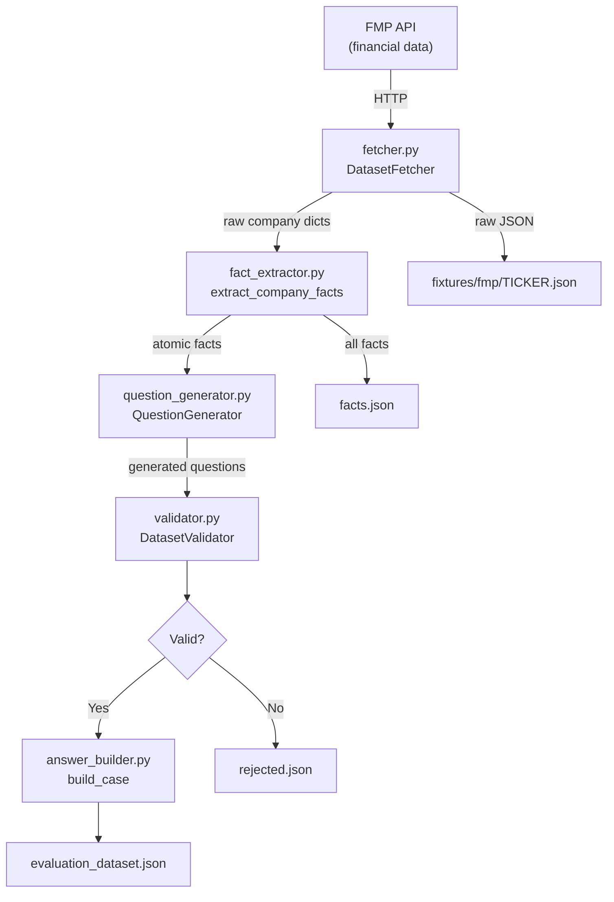

# Dataset Generator

Synthetic evaluation-dataset pipeline for the financial-data AI agent.  
It fetches real financial data from the [FMP API](https://financialmodelingprep.com/), extracts atomic facts, asks an LLM to write natural-language questions, validates those questions with a second LLM pass, and assembles a ground-truth evaluation dataset.

---

## Table of Contents

- [Directory Structure](#directory-structure)
- [Architecture](#architecture)
- [Pipeline Flow](#pipeline-flow)
- [Module Reference](#module-reference)
- [Key Assumptions](#key-assumptions)
- [Configuration](#configuration)
- [Outputs](#outputs)
- [Running the Pipeline](#running-the-pipeline)

---

## Directory Structure

```
evals/dataset_generator/
├── pipeline.py            # Orchestrator — runs the full end-to-end pipeline
├── fetcher.py             # Step 1 — fetch company data from FMP API
├── fact_extractor.py      # Step 2 — convert raw financial statements → atomic facts
├── question_generator.py  # Step 3 — LLM generates questions from facts
├── answer_builder.py      # Step 4 — assemble a ground-truth evaluation case
├── validator.py           # Step 5 — deduplicate + LLM-validate each question
└── prompts/
    ├── question_generation..md   # System prompt for question generation LLM
    └── validation_question.md    # System prompt for validation LLM
```

> **Note:** `__pycache__/` is auto-generated by Python and should be in `.gitignore`.

---

## Architecture



---

## Pipeline Flow

The five steps executed by `pipeline.py`:

| Step | Module | Description |
|------|--------|-------------|
| 1 | `fetcher.py` | Randomly samples `NUM_COMPANIES` tickers, fetches profile + 3 financial statements from FMP, saves JSON fixtures |
| 2 | `fact_extractor.py` | Maps each numeric field in each statement period into a **fact** dict with a deterministic `fact_id` |
| 3 | `question_generator.py` | Groups facts by `(ticker, statement)`, sends metadata (no raw values) to an LLM to write questions |
| 4 | `validator.py` | Deduplicates questions, validates each with a second LLM call, filters bad/ambiguous questions |
| 5 | `answer_builder.py` | Builds a ground-truth case dict containing the question, expected value, and provenance |

---

## Module Reference

### `pipeline.py`

Entry point. Calls each stage in sequence and writes three output files.

```
run_pipeline()
  ├── fetcher.run()                   → list[company_dict]
  ├── extract_company_facts(...)      → list[fact]
  ├── generator.generate(facts)       → list[question]
  └── validator.validate(questions)   → (accepted, rejected)
```

---

### `fetcher.py` — `DatasetFetcher`

| Method | Purpose |
|--------|---------|
| `get_company_universe()` | Calls `/stock-list` on FMP; returns all available tickers |
| `select_companies(seed)` | Deterministic random sample of `NUM_COMPANIES` tickers |
| `fetch_company_data(ticker)` | Fetches profile + income statement + balance sheet + cash-flow |
| `save_fixture(ticker, data)` | Persists raw response as `FIXTURE_DIR/<TICKER>.json` |
| `run()` | Orchestrates all of the above; skips tickers that raise exceptions |

**Fixture schema saved per ticker:**
```json
{
  "fetched_at": "<ISO-8601 UTC>",
  "data": {
    "ticker": "AAPL",
    "company_name": "Apple Inc.",
    "profile": { },
    "statements": {
      "income_statement": [ ],
      "balance_sheet": [ ],
      "cash_flow_statement": [ ]
    }
  }
}
```

---

### `fact_extractor.py`

Converts raw FMP statement records (already mapped via `database/mapper.py`) into **atomic facts**.

| Function | Purpose |
|----------|---------|
| `is_numeric(value)` | Returns `True` for finite numbers; rejects `None`, booleans, NaN, infinity |
| `make_fact_id(...)` | SHA-256 of `ticker:statement:fiscal_year:period:metric:report_date` → 16-hex-char ID |
| `extract_facts_from_record(...)` | Iterates all non-metadata numeric fields in one statement period |
| `extract_company_facts(...)` | Iterates all statement types and all periods for one company |

**Fact schema:**
```json
{
  "fact_id": "a1b2c3d4e5f6a7b8",
  "ticker": "AAPL",
  "company": "Apple Inc.",
  "statement": "income_statement",
  "metric": "net_income",
  "metric_label": "Net Income",
  "value": 96995000000,
  "fiscal_year": 2023,
  "period": "FY",
  "report_date": "2023-09-30",
  "currency": "USD",
  "filing_date": "2023-11-02",
  "accepted_date": "2023-11-02T18:01:14.000Z"
}
```

> **Important:** `fact_extractor.py` expects **mapped** records (from `database/mapper.py`).  
> Do **not** pass raw FMP JSON directly — field names differ.

---

### `question_generator.py` — `QuestionGenerator`

Uses a **"low" tier LLM** (via `utils/llm_picker.py`) with structured output (`QuestionGenerationSchema`).

- Facts are grouped by `(ticker, statement)` in the pipeline before being passed here.
- **Financial values are deliberately withheld** from the LLM — only metadata (metric name, year, period, currency) is sent. This prevents the LLM from hallucinating numeric answers.
- Output is validated against `QuestionGenerationSchema` (Pydantic), which enforces `fact_ids` linkage.

**LLM input sent:**
```json
[
  {
    "fact_id": "a1b2c3d4e5f6a7b8",
    "company": "Apple Inc.",
    "ticker": "AAPL",
    "metric": "Net Income",
    "year": 2023,
    "period": "FY",
    "currency": "USD"
  }
]
```

**Prompt file:** `prompts/question_generation..md`

---

### `answer_builder.py` — `build_case`

Assembles the final evaluation case from a validated question and the fact lookup dict.

> **Note:** Currently supports **single-fact questions only** (`len(facts) == 1`).  
> Multi-fact (calculation) questions are planned but not yet implemented.

**Case schema:**
```json
{
  "id": "generated-<12-hex>",
  "group": "generated",
  "question": "What was Apple's net income for fiscal year 2023?",
  "ticker": "AAPL",
  "year": 2023,
  "metric": "net_income",
  "value": 96995000000,
  "dataset": "income_statement",
  "period": "FY",
  "currency": "USD",
  "expected": {
    "fact_ids": ["a1b2c3d4e5f6a7b8"],
    "facts": [ {} ]
  },
  "source": {
    "provider": "FMP",
    "endpoint": "income_statement",
    "report_date": "2023-09-30"
  }
}
```

---

### `validator.py` — `DatasetValidator`

Two-pass validation:

**Pass 1 — Structural checks (Python):**
- `fact_ids` is a list of length exactly 1
- Question text is non-empty
- All referenced `fact_id`s exist in the fact lookup
- Question is not a duplicate (normalized via whitespace collapsing + lowercase)

**Pass 2 — LLM check:**
- Sends the question + referenced facts to the validation LLM
- LLM returns `{valid: bool, reason: str}` (`QuestionValidationSchema`)
- If `valid == False`, the question is rejected with the LLM's reason

**Pass 3 — Determinism assertion:**
- After acceptance, re-runs `build_case` and asserts `case["value"] == original["value"]`

**Prompt file:** `prompts/validation_question.md`

---

## Key Assumptions

| # | Assumption |
|---|-----------|
| 1 | Statement records are **pre-mapped** (via `database/mapper.py`) before entering `fact_extractor.py`. Raw FMP field names are not supported. |
| 2 | Only **single-fact questions** are generated and validated. Multi-metric calculation questions are not yet supported. |
| 3 | The random seed `42` in `select_companies()` ensures **reproducible company selection** across runs given the same FMP stock universe. |
| 4 | Financial **values are never shown to the question-generation LLM** — only metric names and years — to avoid the LLM baking in numbers. |
| 5 | The pipeline uses a **"low" tier LLM** (cheap/fast model) for both generation and validation; accuracy vs. cost can be tuned in `llm_picker.py`. |
| 6 | Facts are keyed by a **deterministic SHA-256 ID** (`fact_id`); re-running the pipeline with the same data produces identical fact IDs. |
| 7 | The `accepted_date` and `filing_date` fields may be `None` for some FMP records; they are stored as-is and serialized with `default=str`. |
| 8 | Questions referencing unknown or mismatched `fact_ids` are **silently rejected** (not raised as errors) to keep the pipeline resilient. |

---

## Configuration

All settings live in the top-level `config.py`:

| Variable | Default | Purpose |
|----------|---------|---------|
| `NUM_COMPANIES` | `10` | Number of tickers to sample per pipeline run |
| `STATEMENT_LIMIT` | `5` | Max periods fetched per financial statement |
| `QUESTIONS_PER_BATCH` | `8` | Target questions per fact group (passed to LLM prompt) |
| `FIXTURE_DIR` | `eval/datasets/fixtures/fmp/` | Where raw FMP fixtures are saved |
| `OUTPUT_DIR` | `eval/datasets/generated/` | Where the final dataset files are written |
| `question_generation_prompt` | `evals/dataset_generator/prompts/question_generation..md` | Path to LLM question-gen prompt |
| `validation_question_prompt` | `evals/dataset_generator/prompts/validation_question.md` | Path to LLM validation prompt |

> **Important:** `FMP_API_KEY` must be set as an environment variable (or in `.env`).  
> The pipeline will raise `RuntimeError` at startup if it is missing.

---

## Outputs

| File | Description |
|------|-------------|
| `eval/datasets/fixtures/fmp/<TICKER>.json` | Raw FMP responses per company (for reproducibility/replay) |
| `eval/datasets/generated/facts.json` | All extracted atomic facts |
| `eval/datasets/generated/evaluation_dataset.json` | Final accepted evaluation cases + summary stats |
| `eval/datasets/generated/rejected.json` | Rejected questions with rejection reasons |

**`evaluation_dataset.json` top-level schema:**
```json
{
  "version": 1,
  "generation_method": "hybrid",
  "total_facts": 840,
  "generated_questions": 72,
  "accepted_questions": 58,
  "rejected_questions": 14,
  "cases": []
}
```

---

## Running the Pipeline

```bash
# From the project root
export FMP_API_KEY=your_key_here

python -m evals.dataset_generator.pipeline
# or
python evals/dataset_generator/pipeline.py
```

The pipeline prints progress per ticker and a summary on completion:

```
Fetched AAPL
Fetched MSFT
...
Extracted 840 facts
Generated 12 questions for AAPL
...
Dataset generation complete
Facts: 840
Generated: 72
Accepted: 58
Rejected: 14
Output: eval/datasets/generated/evaluation_dataset.json
```
